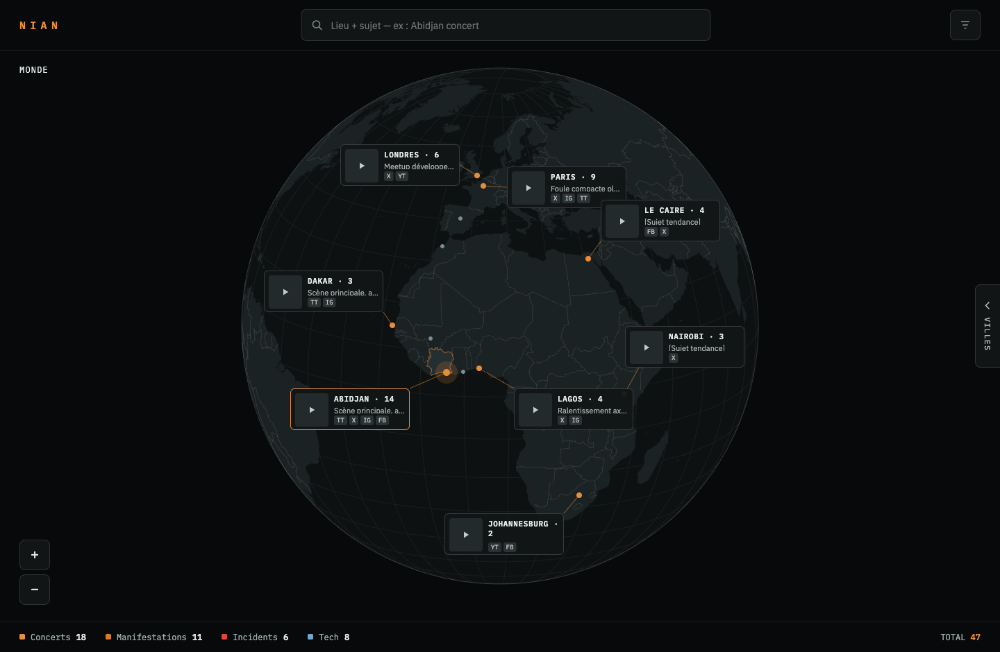
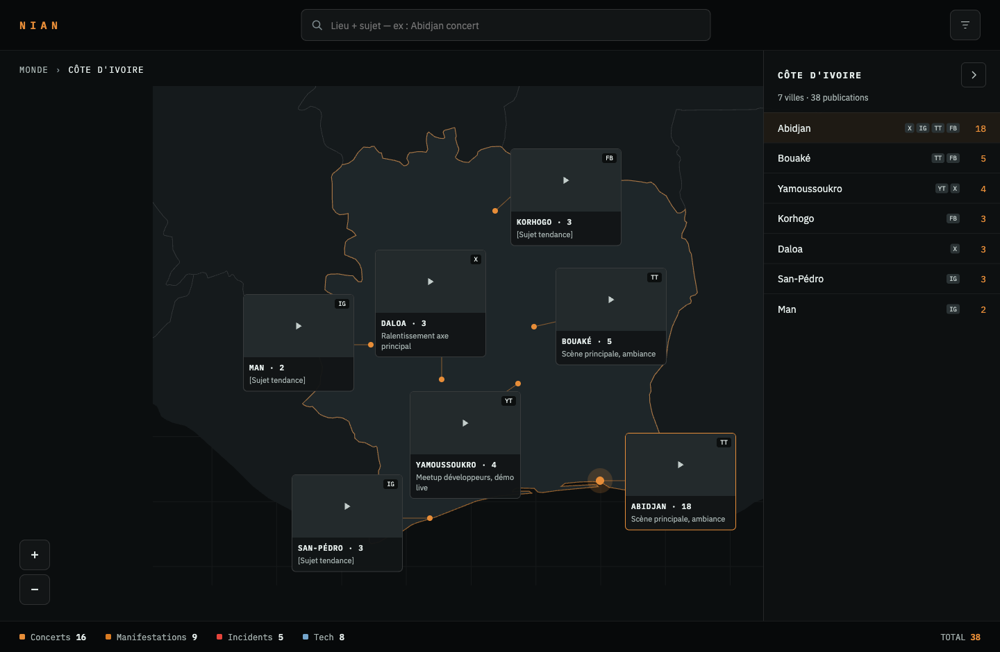
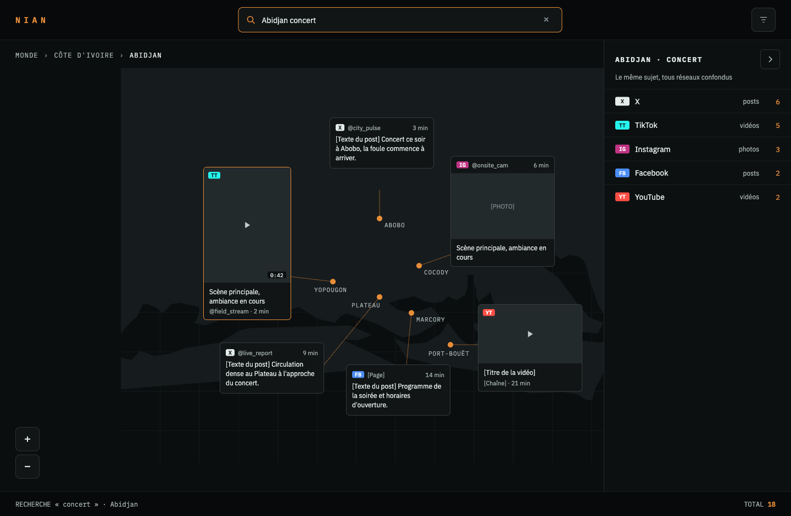

# Nian

Real-time visualization of social-media activity by geolocating publications: **globe → country → city**.

- One card per active city; click a country or a card to drill down to the country, then to the city.
- "Place + topic" search (e.g. `Abidjan concert`): the globe keeps only the results and turns to the place.
- Without a search, recent videos are collected automatically for a list of cities.

## Screenshots

**1 · World** — city cards on the globe



**2 · Country** — click on Côte d'Ivoire



**3 · City** — Abidjan + "concert"



## Installation

```bash
pip install nian-map
```

## Running

```bash
nian --youtube-key AIza...      # then open http://localhost:8100
nian --demo                     # no key: demo data
nian --help                     # all options
```

The key can also be set in the environment or in a `.env` file in the current directory:

```
NIAN_YOUTUBE_KEY=AIza...
```

### YouTube key

Google Cloud Console → enable **YouTube Data API v3** → Credentials → **API key**, restricted to that API.
Free quota: ≈ 10,000 units/day; one search costs 100 units. Nian caps usage at 90 searches/day
(`NIAN_YT_DAILY_SEARCHES`), 20 of which are always reserved for user searches.

## Configuration

| Variable | Default | Purpose |
|---|---|---|
| `NIAN_YOUTUBE_KEY` | — | YouTube Data API v3 key |
| `NIAN_DEFAULT_CITIES` | Abidjan, Paris, Lagos, Dakar, Montreal, Cairo, Tokyo, London | cities collected automatically |
| `NIAN_REFRESH_HOURS` | 6 | automatic collection interval |
| `NIAN_YT_DAILY_SEARCHES` | 90 | daily cap on YouTube searches |
| `NIAN_DB_PATH` | `~/.nian/nian.db` | SQLite database |
| `NIAN_API_TOKEN` | — | if set, search requires the `X-Nian-Token` header |
| `NIAN_ALLOWED_HOSTS` | — | allowed host names in production |
| `NIAN_RETENTION_DAYS` | 30 | how long publications are kept |
| `NIAN_GEOCODER_UA` | nian-map | User-Agent sent to Nominatim (include a contact) |

## Production

Behind a TLS reverse proxy (Caddy, Nginx):

```bash
nian --host 127.0.0.1 --port 8100
```

Single process only: real-time broadcasting and rate limiting are kept in memory.

## Data and licenses

Maps: Natural Earth via world-atlas (public domain). Bundled libraries: d3-geo, d3-array,
topojson-client (ISC); IBM Plex fonts (SIL OFL 1.1).

## License

Nian is licensed under the [Apache License 2.0](LICENSE).

---

Nian is powered by [The Day Info](https://thedayinfo.com).
